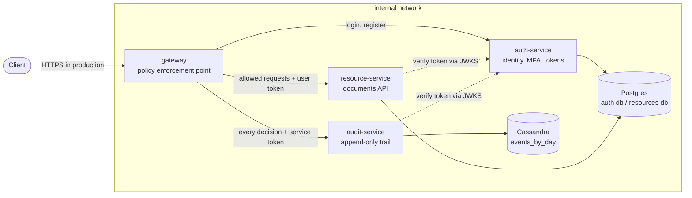

# Zero Trust Microservices

A small Zero Trust platform built as four microservices, for CMPE 272 (Enterprise Software Platforms).
No request is trusted because of where it comes from: every call is authenticated, authorised against
policy, and recorded.

## Architecture



| Service | Responsibility | Store |
|---|---|---|
| `gateway` | Only public entry point. Verifies the token, evaluates policy, audits the decision, forwards. | none |
| `auth-service` | Registration, password + TOTP login, issues 5-minute ES256 tokens, publishes JWKS. | Postgres (`auth`) |
| `resource-service` | Example protected API (`/documents`). Re-verifies the token and role itself. | Postgres (`resources`) |
| `audit-service` | Stores every allow/deny decision. Writes need a service token, reads need an admin. | Cassandra |

Postgres holds users and documents because they need uniqueness and consistent reads. Cassandra holds
audit events because they are write-heavy, never updated, and always read by time range; the table is
partitioned by day so that query hits one partition.

## Run it

Requires Docker. Cassandra needs about 1 GB of RAM and around a minute to start.

```bash
cp .env.example .env   # then fill in both values, e.g. with: openssl rand -hex 32
docker compose up -d --build --wait
```

Run the scripted walkthrough (needs Node 22+ and `npm install` on the host):

```bash
npm run demo
```

It registers an employee, logs in with a TOTP code, and shows allowed and denied requests.

To try the admin path, promote the account the demo printed, then log in again:

```bash
docker compose exec postgres psql -U postgres -d auth -c "UPDATE users SET role='admin' WHERE email='<email>'"
```

An admin can `POST`/`DELETE` `/api/documents` and read `GET /api/audit?day=YYYY-MM-DD`.

### API (through the gateway on `localhost:8080`)

| Method and path | Who | Notes |
|---|---|---|
| `POST /auth/register` | anyone | `{email, password}` (12+ chars). Returns the TOTP secret once. |
| `POST /auth/login` | anyone | `{email, password, totpCode}`. Returns `accessToken`. |
| `GET /api/documents`, `GET /api/documents/:id` | employee, admin | |
| `POST /api/documents`, `DELETE /api/documents/:id` | admin | |
| `GET /api/audit` | admin | Optional `?day=`; defaults to today (UTC). |

## Development

```bash
npm install
npm test
npm run typecheck
```

To install a package inside a running container, name the service and working directory:

```bash
docker compose exec -w /app gateway npm install <package> -w @zt/gateway
```

Set `AUDIT_STORE=memory` on `audit-service` to run without Cassandra.

## SOLID in this codebase

The code is functional (factory functions and plain data, no classes apart from one error type), so
"interface" below means a TypeScript type that describes a set of functions.

- **Single responsibility.** One service per concern; inside a service, `app.ts` is HTTP only,
  domain logic (`accounts.ts`, `policy.ts`) is pure, and storage sits in its own file.
- **Open/closed.** `evaluate` in `gateway/src/policy.ts` never changes; new access rules are new
  entries in `rules.ts`.
- **Liskov substitution.** `createInMemoryUserRepository` and `createPostgresUserRepository` both
  satisfy `UserRepository`; the same holds for the document and audit stores, and tests rely on it.
- **Interface segregation.** Small, single-purpose types: `TokenVerifier`, `AuditSink`,
  `PasswordHasher`, `MfaProvider`. `AuditStore` has no update or delete at all.
- **Dependency inversion.** Each `main.ts` is the composition root that picks concrete
  implementations; everything else receives its dependencies as arguments.

## Threat model (STRIDE)

| Threat | Mitigation |
|---|---|
| Spoofing | scrypt password hashes, mandatory TOTP, ES256-signed 5-minute tokens, service identity for the gateway. |
| Tampering | Schema validation on every body, parameterised SQL/CQL, strict path allowlist in the proxy. |
| Repudiation | Every decision (allow and deny) is audited; access is refused if it cannot be recorded. |
| Information disclosure | Uniform login errors, no secrets or tokens in logs, signing key never leaves memory. |
| Denial of service | Rate limit on login/register, body size limits, upstream timeouts. |
| Elevation of privilege | Deny by default, deny overrides allow, registration cannot set a role, services re-check roles. |

### Known limitations

- Traffic inside the Compose network is plain HTTP. Production would add TLS at the gateway and mTLS between services.
- Both Postgres databases share one superuser, and Cassandra runs without authentication. Neither is reachable from outside the Compose network.
- TOTP secrets are stored unencrypted, and a code can be replayed within its 30-second window.
- There is no enrolment-confirmation step, token revocation, or admin API; roles are changed in SQL.
- The rate limit is per client IP as seen by the gateway, so it needs `trust proxy` configured behind a load balancer.
- Registration reveals whether an email is already taken.
